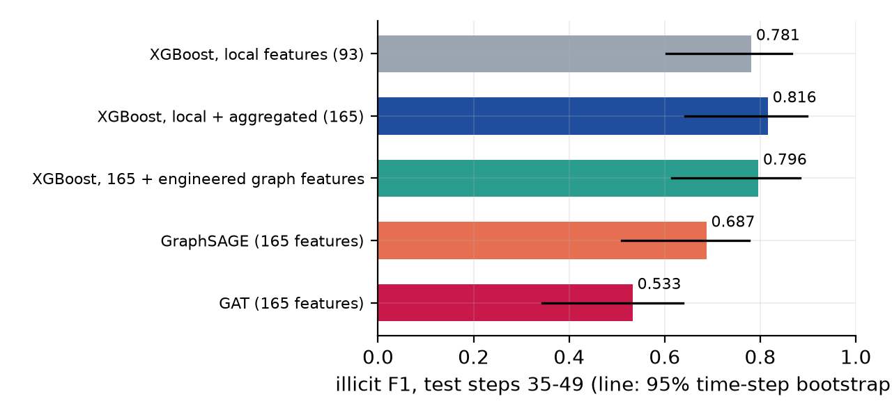
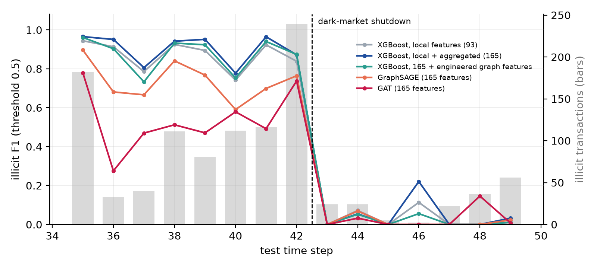

# graph-fraud-drift

[](https://github.com/rkesseku/graph-fraud-drift/actions/workflows/ci.yml)

**Do graph neural networks actually beat gradient boosting for illicit-transaction detection, once you evaluate them honestly over time?**
This repo answers that on the public Elliptic Bitcoin transaction graph with a strict temporal split, five models, several seeds, cost-sensitive alert thresholds and a block bootstrap over time steps, and it shows what happens to every model after a real-world regime change (the dark-market shutdown in the test period).

## Why this exists

Fraud and anti-money-laundering models are usually reported with a random train/test split and a single F1 score. Both hide the two things that matter in production:

1. **Time.** Models are trained on the past and scored on the future, and criminal behaviour changes. A random split leaks future patterns into training.
2. **Decisions.** An alert threshold is a business choice: a missed illicit transaction costs far more than a false alert an analyst has to clear. F1 at 0.5 is not that choice.

The project is also a direct test of a popular claim: that graph neural networks (GNNs) are the natural model for transaction graphs. Here they are compared like-for-like against XGBoost, with and without hand-built graph features.

## Data

[Elliptic Data Set](https://www.kaggle.com/datasets/ellipticco/elliptic-data-set) (Weber et al., 2019): 203,769 Bitcoin transactions, 234,355 directed payment flows and 49 time steps about two weeks apart. Each transaction has 93 local features and 72 features aggregated over its one-hop neighbourhood; feature meanings are anonymised. 46,564 transactions are labelled (4,545 illicit, 42,019 licit, an illicit share of 9.8%); the remaining 157,205 are unlabelled but still take part in the graph. Edges only connect transactions in the same time step.

The data is not redistributed here. Download the three CSV files (`elliptic_txs_features.csv`, `elliptic_txs_classes.csv`, `elliptic_txs_edgelist.csv`) from Kaggle or the PyTorch Geometric mirror into `data/raw/`.

## Method

| Step | What happens |
|---|---|
| Split | Fit on steps 1–29, validate on 30–34, test on 35–49 (16,670 labelled test transactions, 1,083 illicit). After model selection, every model is **refit on 1–34** with the chosen tree or epoch count. The time step itself is never a feature. |
| XGBoost ×3 | Local features only (93); local + aggregated (165); 165 + engineered graph features. Early stopping on validation AUPRC. |
| Graph features | Label-free, so no target leakage: log in/out/total degree, PageRank, mean neighbour degree, and one- and two-hop neighbourhood means of the local features (`graph_features.py`). |
| GNNs | GraphSAGE (mean aggregator) and GAT (4 heads), two layers, written in plain PyTorch (`gnn.py`, no torch_geometric needed), trained full-batch on the whole graph with a class-weighted loss; unlabelled nodes pass messages but never enter the loss. Epochs chosen by early stopping on validation AUPRC. |
| Seeds | 3 seeds per model; tables report mean ± standard deviation. |
| Thresholds | F1 at the conventional 0.5, plus a **cost-optimal threshold** chosen on the validation block, assuming a missed illicit transaction costs 10× a false alert. |
| Uncertainty | 95% intervals from 2000 bootstrap resamples of the 15 test *time steps* (a time step is the natural unit of dependence), pooled over seeds. |
| Drift | Per-step F1 across the test period, and F1 before vs. after the dark-market shutdown at step 43. |

## Results

All numbers below come from one run of `graphfraud run-all` on the full dataset (`docs/results/metrics.json`, log in `docs/results/run_log.txt`). Illicit is the positive class.

| Model | F1 at 0.5 | Precision | Recall | AUPRC | F1 steps 35–42 | F1 steps 43–49 |
|---|---|---|---|---|---|---|
| XGBoost, local features (93) | 0.781 ± 0.009 | 0.892 | 0.696 | 0.783 ± 0.003 | 0.877 | 0.021 |
| XGBoost, local + aggregated (165) | 0.816 ± 0.005 | 0.930 | 0.727 | 0.801 ± 0.002 | 0.910 | 0.029 |
| XGBoost, 165 + engineered graph features | 0.796 ± 0.001 | 0.901 | 0.713 | 0.792 ± 0.011 | 0.895 | 0.018 |
| GraphSAGE (165 features) | 0.687 ± 0.016 | 0.856 | 0.575 | 0.671 ± 0.010 | 0.769 | 0.017 |
| GAT (165 features) | 0.533 ± 0.015 | 0.509 | 0.563 | 0.539 ± 0.022 | 0.602 | 0.029 |

Difference in F1 against XGBoost with local + aggregated features, with 95% time-step bootstrap interval:

| Model | ΔF1 vs. XGBoost (165) | 95% interval |
|---|---|---|
| XGBoost, local features (93) | -0.035 | [-0.045, -0.027] |
| XGBoost, 165 + engineered graph features | -0.021 | [-0.038, -0.009] |
| GraphSAGE (165 features) | -0.130 | [-0.187, -0.083] |
| GAT (165 features) | -0.285 | [-0.389, -0.189] |

Cost-sensitive alerting (threshold chosen on validation; cost per test transaction with missed illicit = 10, false alert = 1):

| Model | Threshold (seed 0) | Cost at 0.5 | Cost at cost threshold | Recall at cost threshold | Precision at cost threshold |
|---|---|---|---|---|---|
| XGBoost, local features (93) | 0.211 | 0.2033 | 0.2068 | 0.754 | 0.526 |
| XGBoost, local + aggregated (165) | 0.059 | 0.1809 | 0.2020 | 0.758 | 0.526 |
| XGBoost, 165 + engineered graph features | 0.112 | 0.1918 | 0.2118 | 0.755 | 0.483 |
| GraphSAGE (165 features) | 0.172 | 0.2826 | 0.2422 | 0.649 | 0.756 |
| GAT (165 features) | 0.446 | 0.3199 | 0.3108 | 0.588 | 0.470 |




### What the numbers say

1. **Gradient boosting wins, clearly.** XGBoost on the 165 provided features is the best model (F1 0.816, AUPRC 0.801). GraphSAGE scores 0.130 F1 lower (interval excludes zero) and GAT 0.285 lower. In this setup, message passing over the transaction graph does not beat a tree model that already sees the dataset's one-hop aggregate features.
2. **Neighbourhood information still matters, in tabular form.** Adding the 72 aggregated (one-hop) features to the 93 local ones raises XGBoost F1 by 0.035 (interval [0.027, 0.045]). Graph structure is useful; the gain comes from summarising it as features, not from a GNN.
3. **More engineered graph features did not help.** Adding degree, PageRank and two-hop means *lowered* F1 by 0.021 (interval [-0.038, -0.009]). Its early-stopped models were much smaller (45-127 trees vs. 450-698), which suggests the extra 191 columns made the small validation block easier to fit by chance rather than adding signal.
4. **Every model collapses after the dark-market shutdown.** F1 on test steps 35-42 is 0.60-0.91 depending on the model; on steps 43-49 it is 0.02-0.03 for all five. None of them catches the new illicit behaviour. That is a monitoring and retraining problem, not a modelling one, and a random train/test split would never reveal it.
5. **A cost threshold chosen on the past does not transfer cleanly.** For XGBoost (165), the validation-optimal threshold (missed illicit = 10x a false alert) raised recall only slightly (0.727 to 0.758) and gave a slightly *higher* test cost than 0.5 (0.202 vs. 0.181 per transaction), because the post-shutdown steps break the conditions it was tuned on. For GraphSAGE it lowered cost (0.283 to 0.242). Alert thresholds need recalibrating on recent data, not setting once.

## Limitations

- One dataset, anonymised features, and labels only for about 23% of transactions; illicit labels come from heuristics described in the Elliptic paper, not from a full audit.
- The GNNs use one reasonable configuration (two layers, hidden size 64 for GraphSAGE, 4×16 for GAT) without a hyperparameter search; a tuned or temporal GNN might narrow the gap. XGBoost was not tuned either beyond early stopping.
- The cost ratio of 10:1 is an assumption chosen to show the method; real ratios depend on the institution.
- The threshold is chosen with the model fitted on steps 1–29 and applied to the model refit on 1–34, a deliberate trade-off to keep the test period untouched.
- The bootstrap treats time steps as exchangeable, which understates uncertainty if drift is systematic; with 15 test steps the intervals are wide.

## How to run

```bash
pip install -e ".[dev]"          # CPU-only PyTorch is enough
graphfraud describe --raw-dir data/raw
graphfraud run-all --raw-dir data/raw --out-dir docs/results   # writes metrics.json and figures
python docs/brief/make_figures.py                                 # figures for the brief
pytest && ruff check src tests                                    # synthetic-graph tests, no download needed
```

A full run took about 115 minutes on a shared 14-core laptop CPU, mostly the GAT.

## Repository layout

```
src/graphfraud/
  data.py            Elliptic CSV loader
  split.py           temporal split (fit / val / train / test, pre/post shutdown)
  graph_features.py  label-free degree, PageRank, multi-hop means
  boosting.py        XGBoost with validation early stopping and refit
  gnn.py             GraphSAGE and GAT in plain PyTorch
  metrics.py         illicit metrics, cost-optimal threshold, time-step bootstrap
  pipeline.py        end-to-end experiment
  plots.py, cli.py, testing.py (synthetic Elliptic-format data)
docs/results/        metrics.json, figures, run log
docs/brief/          5-page project brief (brief.pdf)
```

## Reference

Weber, M., Domeniconi, G., Chen, J., Weidele, D. K. I., Bellei, C., Robinson, T., & Leiserson, C. E. (2019). *Anti-Money Laundering in Bitcoin: Experimenting with Graph Convolutional Networks for Financial Forensics.* KDD Workshop on Anomaly Detection in Finance. arXiv:1908.02591.

## License

MIT, see [LICENSE](LICENSE). The Elliptic data is subject to its own terms.
