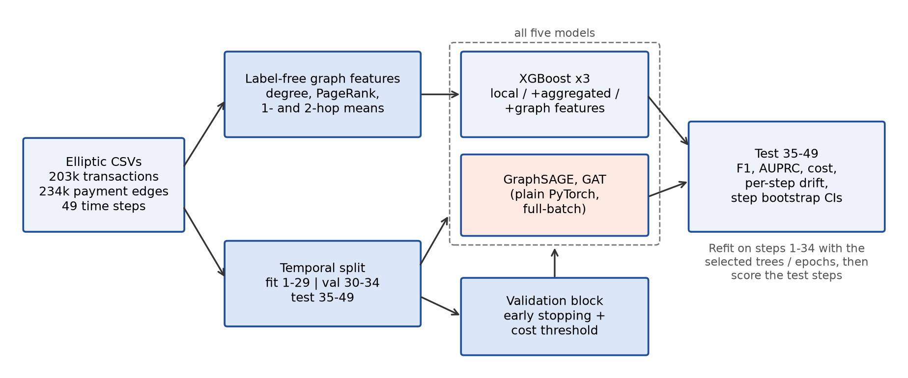
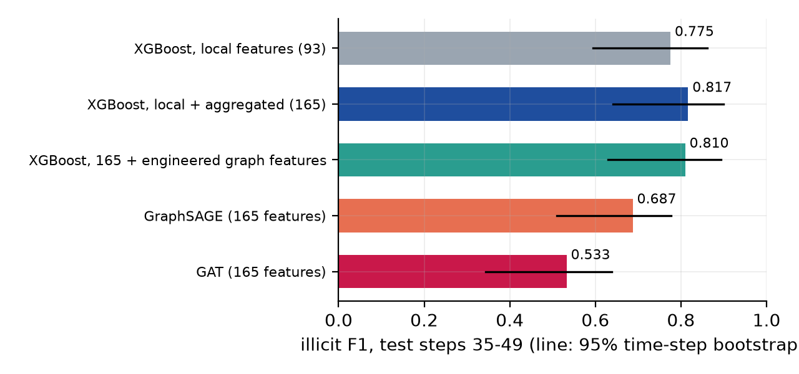
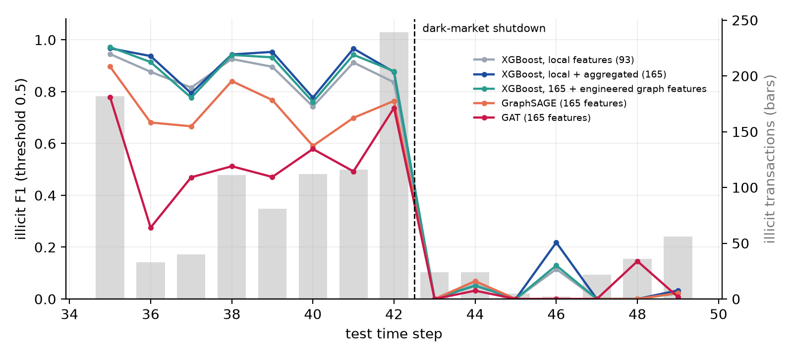

```{=typst}
#set text(hyphenate: false)
#set bibliography(title: "References")
#show bibliography: set par(justify: false)
// Three-rule tables (top, below header, bottom) and bold "Figure N" / "Table N" labels
#set table.hline(stroke: 0.6pt)
#show table: it => box(stroke: (top: 1pt, bottom: 1pt), it)
#show figure.caption: it => context [#strong[#it.supplement~#it.counter.display(it.numbering)#it.separator]#it.body]
#show table: set par(justify: false)
#show heading.where(level: 1): it => block(above: 1.2em, below: 0.6em)[
  #set text(fill: rgb("#1f4e9e"), size: 14pt, weight: "bold")
  #it
]
#show heading.where(level: 2): set text(fill: rgb("#2d2d2d"), size: 11.5pt)
#let glance(body) = block(fill: rgb("#eef3fb"), stroke: (left: 3pt + rgb("#1f4e9e")), inset: 10pt, radius: 2pt, width: 100%, body)
// Header: red title, subtitle, author, repository link
#align(center)[
  #set par(justify: false)
  #text(size: 17pt, weight: "bold", fill: rgb("#b91c1c"))[Graph Fraud Detection under Concept Drift]
  #v(0.5em)
  #text(size: 12pt, weight: "bold")[Do graph neural networks beat gradient boosting for illicit-transaction detection when the evaluation respects time? A controlled test on the Elliptic Bitcoin graph]
  #v(0.9em)
  #text(size: 11pt)[Reagan Kesseku, Ph.D.]
  #linebreak()
  #text(size: 10pt)[#link("https://github.com/rkesseku/graph-fraud-drift")[github.com/rkesseku/graph-fraud-drift]]
  #v(0.45em)
  #text(size: 9.5pt)[#emph[Keywords:] graph neural networks; fraud detection; anti-money laundering; concept drift; temporal evaluation]
]
#v(0.5em)
```

```{=typst}
#glance[
*At a glance* \
*Problem:* Anti-money-laundering models are usually scored on random splits with one F1 number, which hides two production realities: criminals change behaviour over time, and alert thresholds are cost decisions. A popular claim is that graph neural networks are the natural model for transaction graphs. \
*What I built:* A reproducible benchmark on the public Elliptic graph (203,769 transactions, 234,355 payment edges, 49 time steps). It trains five models (three XGBoost feature sets, GraphSAGE and GAT written in plain PyTorch) on a strict past-to-future split with three seeds each. Evaluation covers cost-sensitive thresholds, a bootstrap over time steps and per-step drift analysis. \
*Headline result:* XGBoost on the 165 provided features reached illicit F1 *0.816 ± 0.005* (AUPRC 0.801) on test steps 35–49. GraphSAGE scored 0.130 lower (95% interval [−0.187, −0.083]) and GAT 0.285 lower. After the dark-market shutdown at step 43, *every* model's F1 fell to 0.02–0.03. \
*Stack:* Python, PyTorch, XGBoost, SciPy sparse, scikit-learn, pandas, matplotlib, pytest, GitHub Actions. \
*Repo:* #link("https://github.com/rkesseku/graph-fraud-drift")[github.com/rkesseku/graph-fraud-drift]
]
```

# The problem

Financial-crime teams raise alerts on transactions for analysts to investigate, and a risk model decides where that limited analyst time goes. Two properties of the real setting are routinely lost in published evaluations.

*Time.* A model is trained on what has already happened and used on what happens next. Criminal behaviour shifts, sometimes abruptly. A random train/test split mixes future examples into training and reports a score the deployed model will never achieve.

*Decisions.* Flagging a transaction is a choice with unequal costs: a missed illicit payment is far more expensive than a false alert an analyst clears in minutes. The threshold that turns a score into an alert should reflect that, and it should be chosen without looking at the test data.

Transactions also form a graph, and graph neural networks (GNNs), which learn from that structure directly, are often presented as the obvious choice. This project tests that claim with the same split, features, seeds and metrics for GNNs and for gradient-boosted trees, with and without hand-built graph features.

## The data

The Elliptic data set [@weber2019] is a public graph of Bitcoin transactions. It has 203,769 transactions and 234,355 directed edges, split into 49 time steps about two weeks apart; edges only join transactions in the same step. Each transaction has 93 anonymised local features and 72 features aggregated over its one-hop neighbourhood. 46,564 transactions are labelled: 4,545 illicit (9.8% of labelled) and 42,019 licit. The other 157,205 are unlabelled but remain in the graph, so GNNs can pass messages through them. The original paper notes a dark-market shutdown around step 43, which makes the test period a natural experiment in drift.



# Approach

## Architecture

{#fig-arch width=100%}

## How it works

1. *Temporal split* (`split.py`). Models are fitted on steps 1–29 (26,381 labelled transactions) and validated on 30–34 (3,513). After validation chooses the number of trees or epochs, each model is refit on all of 1–34 (29,894) and tested on 35–49 (16,670 labelled, 1,083 illicit). The time step itself is never used as a feature.
2. *Graph features* (`graph_features.py`). Log in-, out- and total degree, PageRank, mean neighbour degree, and one- and two-hop neighbourhood means of the local features. None of them reads labels, so computing them over the whole graph cannot leak the target.
3. *XGBoost* [@chen2016xgboost] (`boosting.py`). Three feature sets: local only (93), local + aggregated (165), and 165 + the engineered graph features. Each uses early stopping on validation AUPRC, the area under the precision-recall curve, which suits a rare positive class.
4. *GNNs* (`gnn.py`). Two-layer GraphSAGE [@hamilton2017] (mean aggregator) and GAT [@velickovic2018] (four attention heads), written in plain PyTorch with sparse operations, so the package needs no graph library. They are trained full-batch over all 203k nodes with a class-weighted loss; unlabelled nodes pass messages but never enter the loss.
5. *Evaluation* (`metrics.py`). Illicit-class precision, recall, F1 at 0.5 and AUPRC. Cost-optimal thresholds are chosen on validation, assuming a missed illicit transaction costs 10× a false alert. 95% intervals come from 2,000 bootstrap resamples of the 15 test time steps, the natural unit of dependence, pooled over three seeds. Per-step F1 tracks drift.

The test suite builds small synthetic graphs in the same CSV format, so CI runs on Python 3.10–3.12 with no download.



# Results

All figures below come from one run of `graphfraud run-all` on the full data set (115 minutes on a shared laptop CPU, mostly the GAT). They are stored in `docs/results/metrics.json`. Values are means over three seeds, ± one standard deviation.

| Model | F1 at 0.5 | Precision | Recall | AUPRC | F1, steps 35–42 | F1, steps 43–49 |
|---------------------------------|--------------|----------|-------|------|----------------|----------------|
| XGBoost, local (93) | 0.781 ± 0.009 | 0.892 | 0.696 | 0.783 | 0.877 | 0.021 |
| XGBoost, local + aggregated (165) | **0.816 ± 0.005** | **0.930** | **0.727** | **0.801** | **0.910** | **0.029** |
| XGBoost, 165 + graph features | 0.796 ± 0.001 | 0.901 | 0.713 | 0.792 | 0.895 | 0.018 |
| GraphSAGE (165) | 0.687 ± 0.016 | 0.856 | 0.575 | 0.671 | 0.769 | 0.017 |
| GAT (165) | 0.533 ± 0.015 | 0.509 | 0.563 | 0.539 | 0.602 | **0.029** |

: Illicit-class results on test steps 35–49 (16,670 labelled transactions, 1,083 illicit). Bold marks the best value in each column. {#tbl-results tbl-colwidths="[32,15,10,8,9,13,13]"}

{#fig-f1 width=50%}

Against the best model, the F1 differences (95% intervals) are: local features only −0.035 [−0.045, −0.027]; adding engineered graph features −0.021 [−0.038, −0.009]; GraphSAGE −0.130 [−0.187, −0.083]; GAT −0.285 [−0.389, −0.189]. All four intervals exclude zero.

{#fig-drift width=76%}



## Cost-sensitive alerting

| Model | Cost at 0.5 | Cost at val-chosen threshold | Recall | Precision |
|-------------------------|---------------------|-------------------------|------------|------------------|
| XGBoost (165) | **0.181** | **0.202** | **0.758** | 0.526 |
| GraphSAGE | 0.283 | 0.242 | 0.649 | **0.756** |
| GAT | 0.320 | 0.311 | 0.588 | 0.470 |

: Cost per test transaction (missed illicit = 10, false alert = 1) at 0.5 and at the threshold chosen on validation; recall and precision are at the chosen threshold. Bold marks the best value in each column (lowest cost). {#tbl-cost}

# What this demonstrates

*Gradient boosting beat the GNNs, by a wide and statistically clear margin.* With identical inputs and protocol, XGBoost outscored GraphSAGE by 0.13 F1 and GAT by 0.29. The provided features already summarise each transaction's one-hop neighbourhood, and a tree model uses that summary more efficiently than message passing learns it. GAT was also the least stable from step to step.

*Graph information helps when it arrives as features.* The 72 aggregated neighbourhood features added 0.035 F1 to XGBoost. Adding 191 more engineered graph features (degree, PageRank, two-hop means) *reduced* F1 by 0.021. Those models early-stopped at 45–127 trees against 450–698 for the 165-feature model. The extra columns apparently made the small validation block easier to fit by chance; they did not add signal. More features were not better.

*The biggest risk is drift, not model choice.* Before the shutdown at step 43, the best model's F1 was 0.91. Afterwards it was 0.03, and no model did better than 0.03. The models had learned the illicit patterns of a market that disappeared. A random split would report about 0.9 and hide this entirely. In production, the defence is monitoring (alert volumes, score distributions, feedback from analyst reviews) plus a retraining trigger.

*Thresholds are decisions, and they go stale too.* A threshold minimising expected cost on the validation steps cut GraphSAGE's test cost from 0.283 to 0.242 per transaction. For XGBoost it raised recall from 0.727 to 0.758 but *increased* cost slightly (0.181 to 0.202), because the post-shutdown period no longer looks like the validation period. The practical lesson is to recalibrate thresholds on recent labelled data on a schedule, rather than set them once.

*Engineering choices that carry over to production work.* The split is time-respecting and the test period is touched exactly once. Model size is selected on validation and the model refit before testing. The bootstrap uses time steps as the unit, because transactions within a step are not independent. Graph features are label-free, so there is no target leakage. GNNs written in about 200 lines of plain PyTorch keep the dependency surface small and the CI fast.



# Limitations and next steps

- *One dataset, anonymised features.* Elliptic's labels come from heuristics described in the original paper and cover only 23% of transactions. Results may not transfer to card, bank-transfer or other chain data.
- *No hyperparameter search.* Each model uses one reasonable configuration. A tuned GNN, or a temporal GNN that carries state across steps, might narrow the gap; the repo makes that comparison easy to run.
- *Assumed costs.* The 10:1 cost ratio illustrates the method; a real deployment would use the institution's own loss and review-cost estimates.
- *Threshold transfer.* The threshold is chosen on the model fitted to steps 1–29 and applied to the model refit on 1–34, which keeps the test period untouched but adds some mismatch.
- *Bootstrap assumptions.* Resampling 15 test steps treats them as exchangeable, which understates uncertainty when drift is systematic, as it is here.
- *Next steps.* Score-distribution drift alarms, periodic refit and recalibration on a rolling window, and active learning so analyst decisions on new patterns feed back into training.

# How to run it

```bash
pip install -e ".[dev]"            # CPU-only PyTorch is enough
graphfraud describe --raw-dir data/raw
graphfraud run-all --raw-dir data/raw --out-dir docs/results
python docs/brief/make_figures.py
pytest && ruff check src tests      # synthetic-graph tests, no download
```

The three Elliptic CSV files go in `data/raw/`; they are not redistributed in the repo.

